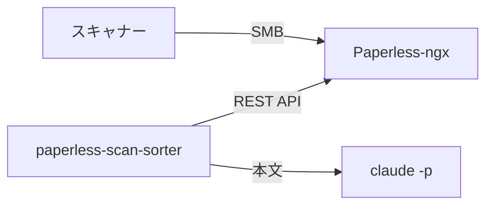

# paperless-scan-sorter

スキャンした書類を、[Paperless-ngx](https://docs.paperless-ngx.com/) と Claude Code で自動的に整理するためのコンテナです。

ネットワークスキャナーが NAS の SMB 共有に保存した PDF を Paperless-ngx が取り込み、OCR します。このコンテナは取り込まれた書類の本文を `claude -p` に読ませ、タイトル・発行元・文書タイプ・タグ・書類日付を判定して Paperless の REST API で書き戻します。ディスク上のファイルは Paperless のファイル名テンプレートに従って `発行元/年/日付_タイトル.pdf` に配置されます。

> [!NOTE]
> 開発を始めたばかりで、まだ動くものはありません。設計は [`docs/design.md`](docs/design.md) にあります。

## 特徴

- **クラウドを経由しない取り込み。** スキャンから保存までを LAN 内で完結させます
- **API キーを使わない。** Claude のサブスクリプションプラン（`CLAUDE_CODE_OAUTH_TOKEN`）で `claude -p` を動かします
- **迷ったものは人が確認する。** 判定に自信がない書類や、発行元・文書タイプを新規作成した書類は `ai-review` タグを付けて区別します
- **LLM には何も変更させない。** Claude は JSON を返すだけで、Paperless の操作はこのコンテナが検証を通した値でだけ行います
- **Paperless 本体には手を入れない。** 別コンテナとして REST API 越しに動きます

## 構成

詳しくは [`docs/design.md`](docs/design.md) を見てください。

## セットアップ

[`docs/setup.md`](docs/setup.md) と配置例の [`compose.example.yaml`](compose.example.yaml) を見てください。

## 開発

[`CONTRIBUTING.md`](CONTRIBUTING.md) と [`AGENTS.md`](AGENTS.md) を見てください。

## ライセンス

[Apache License 2.0](LICENSE)
